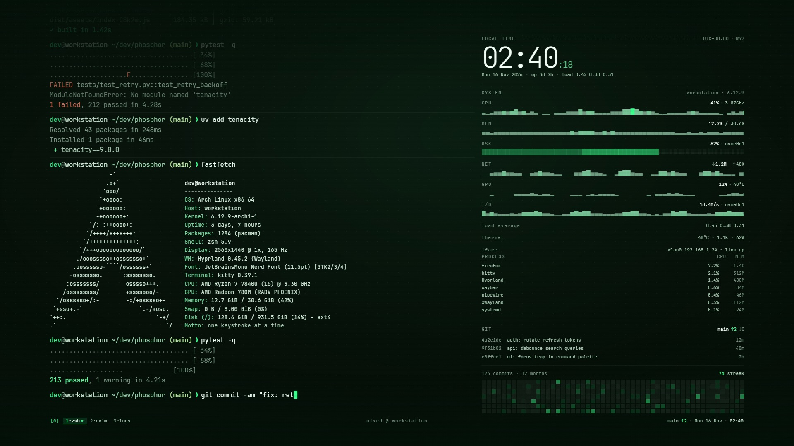

# Phosphor Terminal

An ambient **Linux terminal** wallpaper for [Wallpaper Engine](https://www.wallpaperengine.io/).
A zsh session types itself on a quiet desktop: fastfetch with the Arch logo, a tmux statusline,
a btop-style rail, and real command output from `git`, `cargo`, `pytest`, `docker`, `journalctl`
and friends. The terminal sits directly on the desktop base — no window chrome, no pane, no box.



## What it is

- **A live shell, not a screenshot.** Commands type with human cadence, occasional typos,
  `^C`, and long idle pauses. Output streams in with aligned columns and ANSI colour; the
  prompt is always live.
- **Five session pools.** Mixed, frontend/dev-server, Rust/systems, Python/data and
  containers/git. Each has its own rail telemetry, process list, git state and command set.
- **Twelve distinctly art-directed palettes.** Green phosphor, true monochrome amber CRT,
  warm Gruvbox brown, olive Everforest, ink-and-gold Kanagawa, plum Rosé Pine, pastel
  Catppuccin, electric Tokyo Night, neon Dracula, polar Nord, warm paper-light and
  grayscale. Each palette has its own background tint, syntax roles, prompt colours and
  chrome accent.
- **Seamless composition.** No terminal pane, border or veil: the text and the tmux-style
  statusline sit on the wallpaper itself. The right rail is offset below the top edge so
  the clock does not crowd the corner.
- **Made for a desktop.** The layout is tested at 3840×2160 physical (200% Windows
  scaling, CEF viewport 3840×2160), 3440×1440, 2560×1440, 1920×1080, 1366×768 and
  1080×1920. Frame margins and the scrollback fade keep the first glyphs clear of desktop
  icons; a bottom safe area keeps the tmux bar above the Windows taskbar.
- **Quiet by design.** One `requestAnimationFrame` loop, the FPS limit from Wallpaper
  Engine is respected, charts update at 2 Hz, grain at 12 fps, pause freezes cleanly,
  `prefers-reduced-motion` is supported, and the wallpaper never makes a network request.
- **Optional audio glow.** If audio processing is enabled in Wallpaper Engine, bass
  gently modulates the bloom and caret; otherwise the wallpaper stays static.

## Palettes

| Theme | Character |
| --- | --- |
| Phosphor | Green CRT; monochrome-leaning phosphor greens |
| Amber CRT | Warm amber phosphor; no cool accents except an ember error red |
| Gruvbox | Warm brown paper and tungsten; orange, yellow, warm green |
| Everforest | Olive moss and cream; gold and green, no cyan |
| Kanagawa | Warm ink, gold chrome and vermilion prompt |
| Rosé Pine | Saturated plum dusk; rose, gold and iris |
| Catppuccin | Cool pastel mocha; lavender, pink and teal |
| Tokyo Night | Midnight indigo and electric blue |
| Dracula | Charcoal with hot pink, violet and lime |
| Nord | Polar ice; blue-grey and frost, deliberately desaturated |
| Paper | Warm sepia daylight; ivory paper, umber text, rust accent |
| Monochrome | Strict high-contrast grayscale |

The *Accent color* property overrides the theme's chrome accent (caret, prompt glyph,
active tmux window, sparkline peaks, contribution grid, git ahead, selection, bloom).
By default each theme uses its own accent; changing the property away from the default
phosphor green switches the whole composition to your colour.

## Install

Requirements: Wallpaper Engine 2.x on Windows (developed and tested against 2.8.42,
CEF 146).

**Recommended — copy and open:**

```powershell
pwsh -File tools/install-wallpaper.ps1 -Launch
```

This copies only the runtime files to
`<wallpaper_engine>\projects\myprojects\phosphor-terminal` and opens the wallpaper.
Pass `-WallpaperEnginePath "D:\...\wallpaper_engine"` if auto-detection fails.

**Manual:**

1. Copy `index.html`, `css/`, `js/`, `preview.jpg` and `project.json` into
   `<wallpaper_engine>\projects\myprojects\phosphor-terminal`.
2. In Wallpaper Engine, open **Installed → Local**, select *Phosphor Terminal*, then
   **Apply**. Properties appear on the right.
3. For the editor: **Create Wallpaper** → drag `index.html` onto the window.

## Customize

All properties are defined once in [`js/properties.js`](js/properties.js);
`project.json` is generated from it.

| Property | Default | What it does |
| --- | --- | --- |
| Color theme | Phosphor | One of the twelve palettes above |
| Accent color (Wallpaper Engine UI) | green | Overrides the theme accent; also tints Wallpaper Engine's UI |
| Session | Mixed | Command pool: Mixed / Frontend / Rust / Python / Containers |
| UI scale (%) | 100 | 70–140; scales the whole composition |
| Typing speed | 5 | 1 = slow, deliberate; 10 = fast |
| Show clock | on | Large local-time block in the rail |
| Clock format | 24h | 24-hour or 12-hour (AM/PM) |
| Show system panel | on | Rail with clock, btop-style vitals, process list and git |
| Show banner and tagline | on | Fastfetch card with the Arch ASCII logo and the `Motto:` line |
| Prompt user | `dev` | `user@host` prompt and fastfetch title |
| Prompt host | `workstation` | Host segment, rail meta and statusline |
| Tagline | `one keystroke at a time` | Fastfetch `Motto:` line |
| CRT scanlines and grain | 35 | 0 = clean; 100 = heavy CRT texture |
| Phosphor glow | 60 | Text bloom and backdrop glow; 0 = crisp |
| Mouse parallax | off | ≤6 px eased offset; disabled for reduced motion/touch |
| Bass-reactive glow | on | Needs audio processing enabled in Wallpaper Engine |

Notes:

- Prompt user/host/tagline are sanitized to a single line and rendered as text.
- The clock and date are real; host, kernel, packages, telemetry and git history are
  synthetic. Nothing reads your machine.
- `paper` is a genuine light theme with its own scanline, grain, veil and vignette
  treatment, not an inverted dark palette.

## Develop

Everything is static; there is no build step and no runtime dependency.

```powershell
npm run serve          # http://localhost:4173
npm run preview        # render preview.jpg with headless Edge/Chrome
npm run gen            # rewrite project.json from js/properties.js
npm run check          # fail if project.json is stale
npm run install:we     # copy runtime files into Wallpaper Engine
```

Test URLs:

| URL | Purpose |
| --- | --- |
| `/` | live wallpaper |
| `/?dev=1` | developer panel (properties, pause, fake audio beat) |
| `/?demo=1&still=1` | curated, deterministic frame for screenshots |
| `/?theme=catppuccin&session=ops&fontscale=120` | override any property |
| `/?fps=15` | simulate Wallpaper Engine's FPS limit |

Open the real renderer without touching your desktop wallpaper:

```powershell
pwsh -File tools/preview-wallpaper.ps1 -Width 1920 -Height 1080 -Borderless -Activate
# Hashtables must be passed by direct invocation, not through `pwsh -File`:
./tools/preview-wallpaper.ps1 -Properties @{ theme = 'nord'; session = 'systems' }
pwsh -File tools/preview-wallpaper.ps1 -Close
```

In-page hooks for automation: `window.__phosphor.getState()`, `.restart('ops')`,
`.frame`; `<html data-render="ready">` after the first composed paint.

## Structure

```
project.json           generated Wallpaper Engine project + user properties
index.html             backdrop, workspace, rail, statusline, CRT layers
css/base.css           palette tokens, type scale, frame/rail geometry, overlays
css/terminal.css       scrollback mask, prompt, ANSI colours, fastfetch, caret
css/rail.css           clock, vitals, process list, git, contribution grid
js/properties.js       single source of truth for properties (Node + browser)
js/we-api.js           Wallpaper Engine bridge: properties, pause, FPS, audio
js/content.js          command pools and hand-written outputs
js/terminal.js         composition, typing/reveal engine, static fitting
js/rail.js             clock, sparklines, process list, git
js/fx.js               grain tile, audio modulation, parallax
js/app.js              boot, property wiring, RAF loop, test hooks
tools/                 project.json generator, preview/install scripts, dev server
docs/RESEARCH.md       scene-vs-web research, Wallpaper Engine runtime notes
```

Scripts are classic `<script>` tags on purpose: Wallpaper Engine loads the page from
`file://`, where ES modules and `fetch()` are not usable. All paths are relative.

## Runtime notes

- The web renderer is CEF/Chromium 146 on the development machine. The page also runs in
  any current Chromium for development.
- On a 3840×2160 display at 200% Windows scaling, Wallpaper Engine gives the page a
  3840×2160 CSS viewport (dpr 1). The layout scales to that physical viewport rather than
  assuming a 1920 CSS width.
- The tmux statusline is lifted by a taskbar safe area (`--safe-bottom`) so it stays
  visible above a bottom Windows taskbar.
- Rendering: one RAF loop, hard-capped at 60 and throttled to the FPS setting from
  `applyGeneralProperties`; typing and reveals are tick-driven, so pause freezes them
  without leaking timers.
- No external requests, fonts, images or analytics. Grain is rasterized once; everything
  else is CSS and text.
- Audio visualization requires *Audio processing* enabled in Wallpaper Engine; it is
  input-only and never plays sound.

## Research

The scene-vs-web decision, project format details and property payload formats are
documented in [docs/RESEARCH.md](docs/RESEARCH.md).
